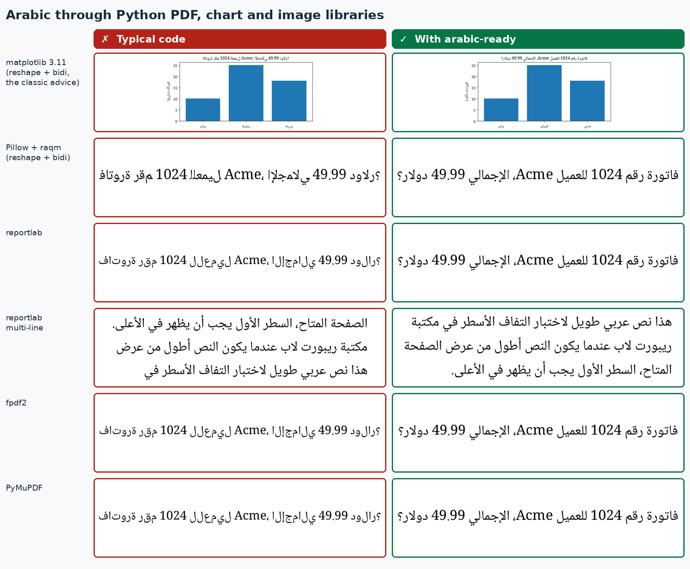
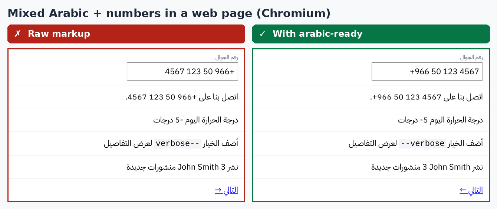
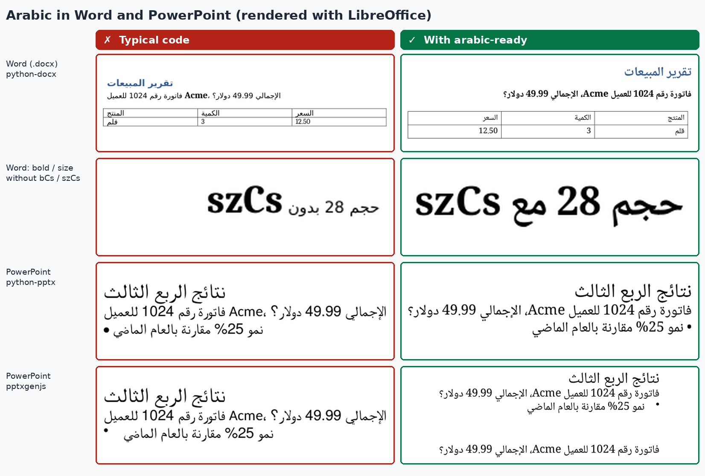

# arabic-ready

**Arabic output from Claude that's right the first time: connected letters, correct right-to-left layout, numbers and English in the right place, in any format.**





## Install

**Claude Code** (two lines):

```
/plugin marketplace add jubyuhanna-create/arabic-ready
/plugin install arabic-ready@arabic-ready
```

**Claude.ai:** download [`arabic-ready.zip`](arabic-ready.zip), then go to **Settings → Capabilities → Skills → Upload skill** and pick the zip. Code execution must be enabled.

## Just ask in Arabic. No setup.

There are no commands, flags or config. Ask for anything in Arabic, or ask in English for something meant for Arabic speakers ("an Arabic landing page", "a Word report for our Cairo office", "RTL support"), and the skill loads itself.

## What it fixes

- **Disconnected or reversed letters** in PDFs, charts and images. It knows which libraries shape Arabic (browsers, WeasyPrint, LibreOffice, matplotlib ≥ 3.11, Pillow with raqm, fpdf2 with shaping) and which don't (reportlab, PyMuPDF `insert_text`, older matplotlib). It never shapes twice, which is the classic fix that breaks modern matplotlib and Pillow.
- **Right-to-left layout** on the web and mobile: `dir`/`lang`, logical CSS (`margin-inline-start`, Tailwind `ms-*`/`pe-*`/`text-start`), React Native start/end, Flutter `EdgeInsetsDirectional`, and what should and shouldn't flip.
- **Mixed Arabic + English/numbers**: phone numbers, negative numbers, emails, URLs, code and English names isolated so nothing jumps sides. Phone/email inputs stay LTR.
- **Icons**: mirrors arrows, chevrons and send; leaves play, check and clock alone.
- **Word and PowerPoint**: `w:bidi`/`w:rtl`, the `szCs`/`bCs` trap (Arabic ignores normal bold/size), RTL tables, `rtl="1"` slides, and the pptxgenjs `rtlMode` quirk.
- **Typography**: a curated list of free Google Fonts, Arabic line-height, tashkeel room, and no letter-spacing, italic or uppercase.
- **Natural Arabic**: MSA by default, dialects on request, `،` `؛` `؟` punctuation, digits chosen by market, `Intl` with explicit `nu`/`ca`, Hijri dates, currencies, plural forms.
- **A linter**: `scripts/rtl_check.py` flags RTL bugs with `file:line`, the problem and the exact fix, and returns a CI-friendly exit code. Claude runs it on its own output.



## How it's built

```
skills/arabic-ready/
├── SKILL.md              core rules (short) + which reference to read
├── references/           web · bidi · typography · documents · charts-images · writing
└── scripts/
    ├── rtl_check.py      RTL linter (stdlib only)
    └── shape_text.py     reshape + bidi for renderers that can't shape (stdlib fallback built in)
```

- **Every library claim was tested.** Each technique in `documents.md` and `charts-images.md` was run, rendered to an image and inspected, and the code snippets in those files are executed verbatim by `evals/verify/v_snippets.py`. Versions and evidence: [`evals/verify/README.md`](evals/verify/README.md).
- **Evals**: 12 prompts, each run with and without the skill and rendered side by side: [`evals/README.md`](evals/README.md). The results are reported as they came out. Current Claude models already get most Arabic right. The skill mainly removes the remaining latent bugs and the trial-and-error.
- **Tests**: `python -m unittest discover tests`

Not tested here: Microsoft Word/PowerPoint themselves (LibreOffice was the renderer), Safari/Firefox, and React Native/Flutter on a device.

---

## بالعربية

**مهارة لـ Claude تجعل أي مخرجات عربية صحيحة من أول مرة:** حروف متصلة، واتجاه من اليمين إلى اليسار، وأرقام وكلمات إنجليزية في مكانها الصحيح، سواء كانت المخرجات صفحة ويب أو تطبيقًا أو ملف Word أو PowerPoint أو PDF أو رسمًا بيانيًا أو صورة أو رسالة واتساب.

**التثبيت في Claude Code:**

```
/plugin marketplace add jubyuhanna-create/arabic-ready
/plugin install arabic-ready@arabic-ready
```

**في Claude.ai:** نزّل الملف `arabic-ready.zip`، ثم افتح الإعدادات ← القدرات ← المهارات ← رفع مهارة.

**لا إعدادات ولا أوامر.** اطلب ما تريد بالعربية وستعمل المهارة تلقائيًا.

ما الذي تصلحه:
- الحروف المتقطعة أو المعكوسة في ملفات PDF والرسوم البيانية والصور
- اتجاه الصفحات والتطبيقات (CSS المنطقي، Tailwind، React Native، Flutter)
- أرقام الجوال والبريد والروابط والكلمات الإنجليزية داخل النص العربي
- الأيقونات الاتجاهية، والخطوط العربية المناسبة، وتباعد الأسطر
- ملفات Word وPowerPoint باتجاه صحيح وخط عريض وحجم يطبَّقان على النص العربي
- صياغة عربية طبيعية بالفصحى، وعلامات الترقيم العربية، واختيار الأرقام والتاريخ والعملة حسب البلد

---

If this saves you from one more reversed Arabic PDF, **please ⭐ star the repo** so others can find it.

إذا وفّرت عليك هذه المهارة ملف PDF عربيًا معكوسًا واحدًا على الأقل، **ادعمها بنجمة ⭐**.

MIT License
